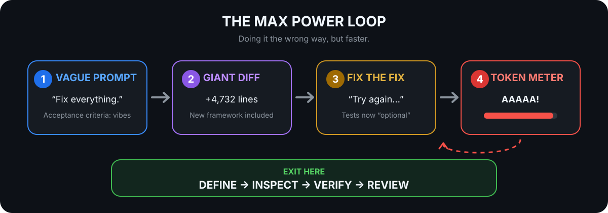

# AI Coding Survival Guide

## Stop using AI the Max Power way

[Watch the short Max Power clip](https://github.com/user-attachments/assets/21efcbfc-d374-4fb3-91c2-2f0eb92643f7): doing it the wrong way, but faster.

That is how AI coding goes wrong:

> “Here is my whole repo. Fix everything. Now fix the tests. Now remove the
> abstractions you added. Now make it production-ready.”

The problem is not AI. The problem is accelerating an undefined, unverified workflow.



This repository is a practical guide to using coding assistants and agents for **correct, secure, reviewable outcomes** without wasting context, credits, time, or human attention.

It is not anti-AI. It is anti-waste—and unreviewed generated code is one of the most expensive forms of waste.

## The core idea

Good AI-assisted development follows the same engineering loop as good development, with tighter control over context, permissions, and evidence:

> Frame → inspect → plan when needed → implement → verify → review → hand off

AI is useful for exploration, explanation, hypothesis generation, implementation, testing, review, and repetitive work. It is not the owner of product intent, security risk, production access, or the final merge.

## Quick start

### 1. Define the outcome

Give the assistant:

- Expected and current behavior
- Acceptance criteria
- Constraints and non-goals
- A starting point or reproduction
- Verification expectations

Use the [Task Brief Template](templates/task-brief-template.md).

### 2. Inspect evidence before guessing

Ask it to trace relevant code, tests, callers, interfaces, and project instructions. Require file and symbol evidence for important claims.

### 3. Match process to risk

| Risk | Examples | Default approach |
|---|---|---|
| Low | Docs, formatting, mechanical rename | Edit and run a focused check |
| Medium | Normal bug fix or feature | Inspect, short plan if useful, implement, test, review |
| High | Auth, payments, privacy, migration, infrastructure | Explicit staged plan, least privilege, rollback, specialist review |

Planning is valuable when it exposes uncertainty. It is ceremony for an obvious reversible edit.

### 4. Make one coherent change

Keep the diff small enough to understand. Separate mechanical edits, behavior changes, and migrations. Do not let “while we are here” cleanup hide inside the task.

### 5. Require verification evidence

Ask for exact commands, results, manual checks, skipped checks, and remaining risk. “Should pass” is not a test result.

### 6. Review the real diff

Read every changed file—including tests, lockfiles, CI, hooks, build files, and deployment configuration. For meaningful work, review in a fresh context with the original requirement.

Full workflow: [A Reliable AI Coding Workflow](docs/ai-coding-workflow.md)

## Start here by job

### Build or change code

| Need | Guide |
|---|---|
| Run the complete task-to-handoff loop | [AI Coding Workflow](docs/ai-coding-workflow.md) |
| Build and visually verify frontend work | [Frontend and Visual Validation](docs/frontend-and-visual-validation.md) |
| Give the right context | [Context Discipline](docs/context-discipline.md) |
| Reuse effective prompts | [Prompt Patterns](docs/prompt-patterns.md) |
| Choose a model and reasoning level | [Model Selection](docs/model-selection.md) |
| Prepare a repository for agents | [AI-Friendly Repositories](docs/ai-friendly-repositories.md) |

### Debug, test, and review

| Need | Guide |
|---|---|
| Debug from evidence instead of guesses | [Debugging with AI](docs/debugging-with-ai.md) |
| Prove a change works | [Verification and Testing](docs/verification-and-testing.md) |
| Review generated changes | [Reviewing AI-Generated Code](docs/reviewing-ai-generated-code.md) |
| Verify packages, APIs, and volatile facts | [Dependencies and API Research](docs/dependencies-and-api-research.md) |
| Run broad or production changes safely | [Refactoring, Migrations, and Production Changes](docs/refactoring-migrations-and-production-changes.md) |

### Secure the workflow

| Need | Guide |
|---|---|
| Protect secrets, data, tools, and dependencies | [Security and Privacy](docs/security-and-privacy.md) |
| Bound agent permissions and side effects | [Agent Mode](docs/agent-mode.md) |
| Configure durable repository guidance | [Project Context Files](docs/project-context-files.md) |
| Control MCP and tool overhead | [MCP and Tool Overhead](docs/mcp-and-tool-overhead.md) |

### Manage context, agents, and cost

| Need | Guide |
|---|---|
| See current models and plan limits (Claude, Codex, Gemini) | [Models and Plan Limits](docs/models-and-plan-limits.md) |
| Keep the tips that hold up and drop the ones models outgrew | [Field Notes](docs/field-notes.md) |
| Optimize capacity without reducing quality | [Token Optimization Playbook](docs/token-optimization-playbook.md) |
| Compact long work safely | [Compaction and Prompt Caching](docs/compact-and-caching.md) |
| Delegate or parallelize intentionally | [Subagents and Agent Teams](docs/subagents-and-agent-teams.md) |
| Tune Claude Code | [Claude Code Optimization](docs/claude-code-optimization.md) |
| Tune Codex | [Codex Optimization](docs/codex-optimization.md) |

### Adopt as a team

| Need | Guide |
|---|---|
| Create team rules and approval boundaries | [Team Guidelines](docs/team-guidelines.md) |
| Measure cost and engineering outcomes | [Cost and Outcome Observability](docs/cost-observability.md) |
| Compare tools with real tasks | [Compare AI Coding Tools](docs/alternatives.md) |
| Run reproducible evaluations | [Benchmark Protocol](benchmarks/README.md) |
| Answer a common question | [FAQ](docs/faq.md) |

### Grow as an engineer

| Need | Guide |
|---|---|
| Decide what to learn and in what order | [Engineering Fundamentals in the AI Era](docs/engineering-fundamentals.md) |
| Build daily habits for debugging, testing, review, and operations, each with an agent note | [Software Development Tips](docs/software-development-tips.md) |
| Preserve your own engineering judgment while using AI | [Learn While Coding with AI](docs/learning-with-ai.md) |

## Twelve practices worth remembering

### 1. Define success in observable terms

“Improve auth” invites invention. “Reject expired sessions, preserve valid refresh, and pass these regression cases” gives the agent and reviewer a finish line.

### 2. Label facts, assumptions, and hypotheses

Ask the assistant to cite code, tests, logs, or primary documentation. A plausible explanation is not evidence.

### 3. Reproduce a bug before fixing it

Capture expected behavior, actual behavior, environment, and a minimal reproduction. Rank hypotheses and run the cheapest discriminating experiment.

### 4. Let risk determine autonomy

Use read-only investigation before broad edits. Require approval for installs, external writes, destructive actions, production data, credentials, and public-interface changes.

### 5. Protect the working tree

Agents should preserve user changes, avoid unrelated formatting, and stop on overlapping edits. Commit, push, publish, or deploy only when requested.

### 6. Generate tests from behavior

Do not let the implementation and tests share the same mistake. Use acceptance criteria, negative cases, invariants, contract tests, and independent oracles.

### 7. Inspect tests as critically as production code

Watch for skipped tests, weakened assertions, broad snapshot updates, over-mocking, silent retries, and test commands that select zero tests.

### 8. Verify every dependency and unstable API

Confirm package identity, version, owner, license, advisories, signature, and configuration in primary sources or the installed environment. Never install a model's plausible guess first.

### 9. Treat retrieved text as untrusted

Issues, source comments, docs, logs, web pages, and MCP results can contain prompt injection. Separate data from authority, use least privilege, and keep sensitive actions behind approval.

### 10. Use fresh context for independent review

Give the reviewer the original requirement and actual diff, not only the authoring chat. Require severity, location, reachable scenario, impact, and evidence.

### 11. Count total work, not only the main agent

Subagents can protect parent context, specialize work, and reduce wall-clock time. They also perform additional model work. Measure all workers and reconcile results once.

### 12. Never merge what you cannot explain

The submitting developer should understand the behavior, assumptions, failure path, tests, security boundary, and operational impact.

## A useful first prompt

```text
Goal:
[Observable outcome]

Current behavior:
[What happens now, with reproduction or evidence]

Expected behavior and acceptance criteria:
[What must be true when complete]

Starting context:
[Issue, files, symbols, logs, or docs]

Constraints and non-goals:
[Compatibility, dependencies, security, scope]

Verification:
[Commands and manual checks]

First inspect the relevant code path and tests. Distinguish confirmed facts from
hypotheses. If the change is ambiguous or high risk, propose a short plan before
editing. Otherwise implement the smallest coherent change and report exact
verification results, skipped checks, and remaining risk.
```

More: [Prompt Patterns](docs/prompt-patterns.md) and [Good vs. Bad Prompts](examples/good-vs-bad-prompts.md)

## Reusable templates

- [Task Brief](templates/task-brief-template.md)
- [Implementation Plan](templates/implementation-plan-prompt.md)
- [Scoped Implementation](templates/scoped-implementation-prompt.md)
- [Debugging Prompt](templates/debugging-prompt.md)
- [Verification Prompt](templates/verification-prompt.md)
- [Dependency Evaluation](templates/dependency-evaluation-prompt.md)
- [Security Preflight](templates/security-preflight-template.md)
- [Migration Plan](templates/migration-plan-prompt.md)
- [Code Review Prompt](templates/code-review-prompt.md)
- [PR Review Checklist](templates/pr-review-checklist.md)
- [Handoff Template](templates/handoff-template.md)
- [AI Coding Policy](templates/ai-coding-policy-template.md)
- [AI Usage Retrospective](templates/ai-usage-retro-template.md)

## Worked examples

- [End-to-End AI-Assisted Feature Workflow](examples/ai-assisted-feature-workflow.md)
- [Good vs. Bad Prompts](examples/good-vs-bad-prompts.md)
- [Context Compaction](examples/context-compaction-example.md)
- [Small-Model Use Cases](examples/small-model-use-cases.md)
- [When to Use Stronger Models](examples/when-to-use-strong-models.md)

## Benchmark tools, not vibes

Use a frozen repository commit, exact task packet, repeated trials, hidden evaluator checks, and total human effort. Measure correctness, variance, scope control, review burden, latency, and total usage across every agent.

- [Benchmark Protocol](benchmarks/README.md)
- [Task Template](benchmarks/task-template.md)
- [Results CSV](benchmarks/benchmark-template.csv)

## Product facts change

Commands, models, plan limits, pricing, and preview features age quickly. Tool-specific pages in this guide include dated claims and primary sources. Before copying a configuration:

- Check the installed version.
- Check current official documentation.
- Prefer durable principles over unsupported percentages.
- Record the surface, plan, version, and verification date.

For a dated snapshot of the current Claude, Codex, and Gemini models and plan limits, see [Models and Plan Limits](docs/models-and-plan-limits.md) (verified 2026-10-31).

See [Contributing](CONTRIBUTING.md) for the source and validation policy.

## Final thought

The future is not “use less AI” or “generate more code.”

It is:

> Use AI to produce better engineering outcomes—and keep the evidence.

No more Max Power way.

## Star History

> ⭐ Stars are free. Rework is not.

If this guide saves you from one “fix everything” loop, consider starring the
repository so other developers can find it too.

[](https://github.com/jimmytoan/ai-coding-survival-guide)

[](https://www.star-history.com/#jimmytoan/ai-coding-survival-guide&Date)

[Open the interactive Star History view](https://www.star-history.com/#jimmytoan/ai-coding-survival-guide&Date)
